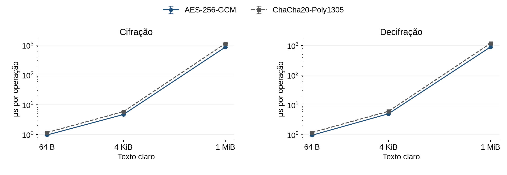
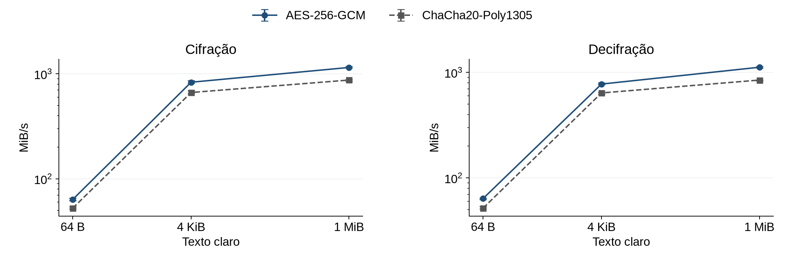

# Resultados dos benchmarks

A coleta ocorreu em 17/11/2026, 00:18:21–00:18:42 UTC, ainda 16/11 no fuso
UTC−03:00. Foram preservadas 439 observações: 48 de aquecimento, 31 de
calibração e 360 medidas. A matriz e as fases seguem o
[método](benchmark-method.md).

## Valores observados

AES-256-GCM teve menor latência mediana nas seis comparações de mesma
operação e tamanho. Na cifração de 1 MiB, as medianas foram 868,854 µs e
1145,447 µs, com vazões de 1150,94 e 873,02 MiB/s, respectivamente.





A [tabela original](../results/tables/benchmarks.md) contém as 12 configurações.
As barras mostram Q1–Q3 das médias por lote. A largura interquartil ficou
entre aproximadamente 2,8% e 5,8% da mediana.

As calibrações alcançaram o alvo. Nas medições, nove lotes ficaram abaixo de
20 ms; as durações foram de 19,164 a 34,760 ms. A contagem já estava fixa,
e nenhum lote foi removido ou substituído.

## Ambiente

Intel Core i5-7200U, quatro CPUs lógicas, Python 3.14.7, cryptography 50.0.2
e OpenSSL 4.0.3. A CPU informou AES, PCLMULQDQ e AVX2, mas não foi medido
qual caminho nativo o backend selecionou. Frequência dinâmica, política
powersave e afinidade foram mantidas.

Os tempos dependem desse ambiente e incluem custos da API Python. A maior
vazão nas mensagens maiores é compatível com diluição de custos fixos, sem
separá-los. Os resultados não demonstram superioridade em outras máquinas.

## Dados

CSV e manifesto ficam em `results/raw/`; as fontes exatas usadas na coleta
ficam em `results/measurement-source/`. Os gráficos dos documentos usam os
mesmos valores com rótulos em português. Para conferir os resumos:

```bash
python -m nonce_reuse analyze --input-dir results/raw --output-dir build/analysis
```

Uma nova coleta deve usar outro diretório e produzirá outros tempos.
